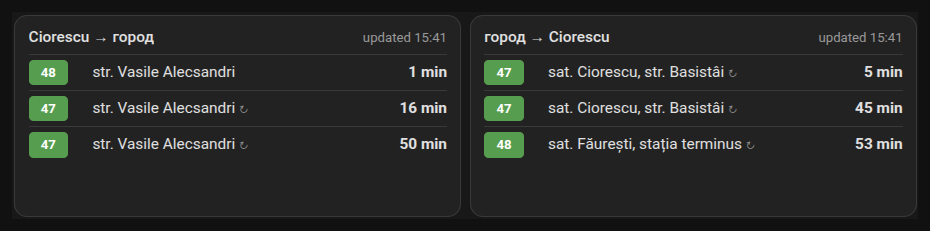
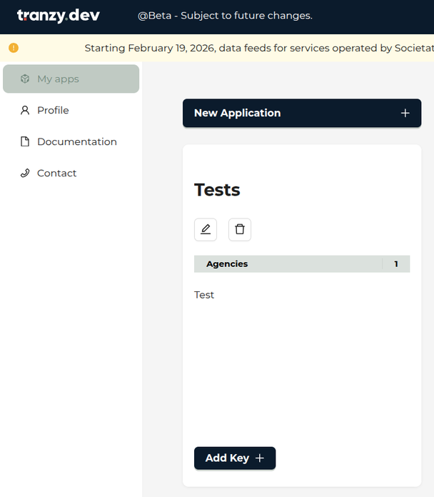
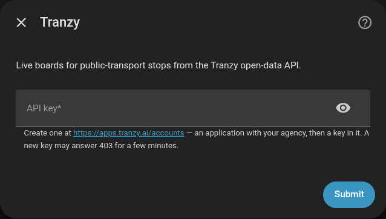
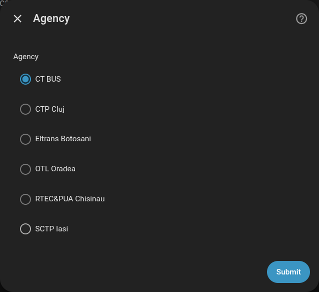
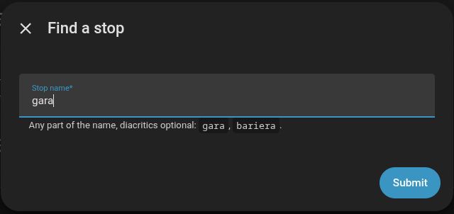
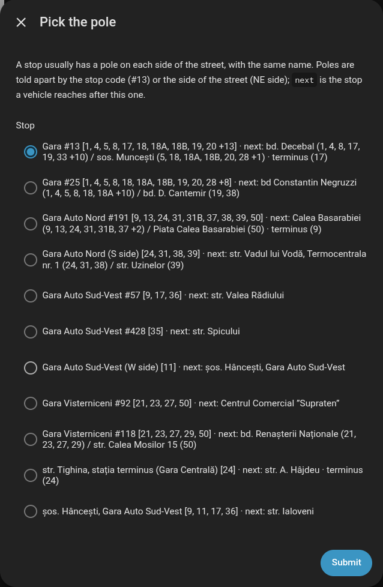
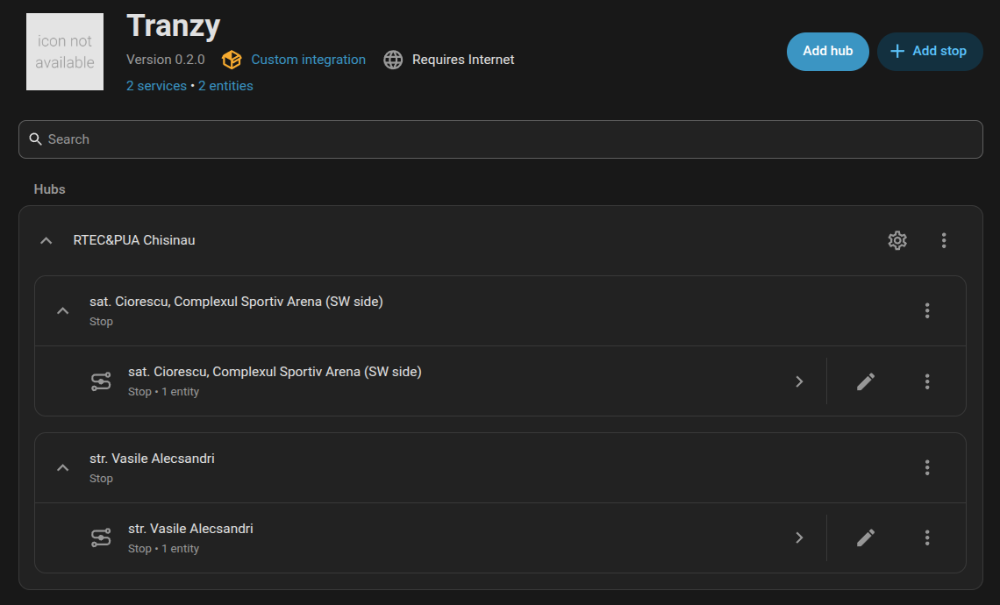
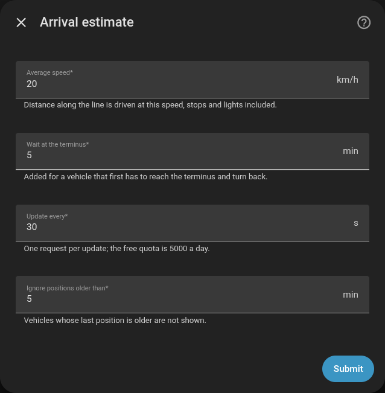

# Tranzy for Home Assistant

Live departure boards for public-transport stops, from the
[Tranzy open-data API](https://tranzy.ai/opendata/). Pick the stops you use, put a
board on the dashboard, see what is coming and in how many minutes.



Works for every agency on the Tranzy platform — RTEC&PUA Chișinău, CTP Cluj, SCTP
Iași, OTL Oradea, Eltrans Botoșani, CT BUS. It was built and tested on Chișinău.

## Why

Tranzy has a live map, and a map can sit on a dashboard in an iframe. But a map
answers "where are the buses", while at the door the question is "when is mine".
That takes finding the stop, finding the route, eyeballing the distance — every
time.

A board answers it directly: the stop you chose, the vehicles coming to it, the
nearest one on top, minutes counting down.

## How it works

The Tranzy feed has live vehicle positions, but **no arrival times**: `stop_times`
gives only the order of stops on a trip, and `shapes` carry no distances. So the
integration estimates them:

1. Every vehicle running a trip is placed on that trip's line (the nearest point of
   the shape).
2. The distance **along the line** — not as the crow flies — to your stop is driven
   at an average speed.
3. The age of the position is subtracted: a fix 40 s old already counts 40 s of the
   trip.
4. A vehicle running **the opposite direction** of the same route is counted too:
   to the terminus, a wait there, and back to your stop. These rows are marked ↻.
5. **At a terminus** the board shows departures: a vehicle arriving there ends its
   trip and takes nobody further, so it is listed with its return trip, after the
   wait.

Positions older than five minutes and vehicles more than 200 m off their line are
ignored. Each vehicle appears once, with its earliest arrival.

Static data — routes, trips, stops, shapes, about 6 MB for Chișinău — is loaded
once a day. Vehicles are fetched every 30 s with a single request shared by all
your stops.

## Installation

**HACS**: *HACS → ⋮ → Custom repositories* → `https://github.com/grigorii-horos/ha-tranzy`,
category *Integration*. Install **Tranzy**, restart Home Assistant.

**By hand**: copy `custom_components/tranzy` into `<config>/custom_components/` and
restart Home Assistant.

The board card is served by the integration itself — there is no dashboard
resource to add, and the card always matches the integration's version.

Home Assistant 2026.9 or newer.

## Setup

### 1. Get an API key

Sign up at <https://apps.tranzy.ai/accounts>. Create an **application**, add your
agency to it, then **Add Key** inside the application.



The free plan allows 5 requests a second and 5000 a day; the integration uses
about 2900 a day at the default 30 s interval.

> A brand-new key answers `403 Forbidden` for a few minutes. If the setup says the
> key was refused right after you made it, wait and try again.

### 2. Add the integration

*Settings → Devices & services → Add integration → Tranzy*. Paste the key:



Then pick the agency. The list is every agency on the platform; only those added
to your key's application will work.



### 3. Add stops

On the Tranzy page, **Add stop**. Type any part of the name — case and diacritics
do not matter, `soseaua` finds `Șoseaua`:



Then pick the pole:



A stop usually has a pole on each side of the street, and both carry the same
name. Each line of the list tells them apart:

- **`#13`** — the stop code, where the feed has one (most of the city).
- **`(NE side)`** — where it has none (most villages): the compass side of this pole
  relative to its twin across the street.
- **`[1, 4, 5, …]`** — the routes that stop at this pole.
- **`next: bd. Decebal (1, 4, 8) / sos. Muncești (5, 18)`** — where a vehicle goes
  after this stop, with the routes that go there. Routes may split right after
  a stop, so each next stop carries its own routes.
- **`terminus (17)`** — routes whose trip ends here.

The next stop is usually the quickest way to tell: it is a place you know, not the
far end of some route.

Each stop becomes a device with one sensor. To see the pole on a map, open the
device and press **Visit** — it opens OpenStreetMap at the pole.



### 4. Put a board on the dashboard

*Edit dashboard → Add card → Tranzy board*, choose the stop's sensor. Or in YAML:

```yaml
type: custom:tranzy-board-card
entity: sensor.gara_13
title: Вокзал        # optional, the stop's name by default
routes: [47, 48]     # optional, only these routes
rows: 6              # optional, arrivals shown on an automatic height
```

## The card

Each row is one vehicle: the route badge (blue for a trolleybus, green for a bus,
red for a tram), where it is going, and the minutes. The nearest is on top;
**now** in amber means it is at the stop or about to be. ↻ marks a vehicle that
first has to reach the terminus and turn back.

Minutes count down in the browser between updates. The header shows when the
data was fetched, and turns amber with *data is stale* when that was more than
three minutes ago.

A tap anywhere on the card opens the sensor.

| Option | Default | |
|---|---|---|
| `entity` | — | the stop's sensor (required) |
| `title` | the stop's name | |
| `routes` | all | show only these routes; the stop has many, you ride one or two |
| `rows` | 6 | how many arrivals on an automatic height |

**Height.** Left on *auto* in the layout, the card is as tall as `rows` arrivals.
Give it a height by hand (*Layout → rows*) and it fills that space, lists every
arrival (up to 20) and scrolls inside when they do not fit — the header stays.

Interface in English and Russian, following the Home Assistant language; in
Russian the badges read `Т 5` / `А 47`.

## The sensor

One per stop, `device_class: duration`, in minutes.

- **State**: minutes to the next vehicle, `unknown` when nothing is on the way.
- **Attributes**:
  - `stop_id`, `stop_name`, `stop_code`
  - `updated` — when the data was fetched
  - `arrivals` — up to 20 of:

```yaml
- route: "47"
  type: bus                 # bus | trolleybus | tram | other
  color: "#000"             # the route colour from the feed
  headsign: sat. Ciorescu, str. Basistâi
  arrival: "2026-11-02T13:41:05+00:00"
  minutes: 9
  vehicle: "830"            # fleet number
  distance_m: 3120          # along the line
  via_terminal: true        # first to the terminus and back
```

`arrivals` and `updated` are not written to the history database.

An automation can use the state directly, for example "notify when the next
vehicle is 5 minutes away"; for one route, read `arrivals` with a template:

```jinja
{{ state_attr('sensor.gara_13', 'arrivals')
   | selectattr('route', 'eq', '5') | map(attribute='minutes') | first }}
```

## Options

*Configure* (the cog on the agency):



| Option | Default | |
|---|---|---|
| Average speed | 20 km/h | stops and lights included; lower it for the rush hour |
| Wait at the terminus | 5 min | added to vehicles that turn back at the terminus |
| Update every | 30 s | one request each; mind the 5000/day quota |
| Ignore positions older than | 5 min | older vehicles are not shown |

## Accuracy

It is an estimate from a position and an average speed, not a timetable:

- Traffic is invisible to it. On a jammed street the minutes run slower than the
  clock.
- The wait at a terminus varies from minutes to half an hour; ↻ rows are the
  least reliable.
- A vehicle that leaves its route, or reports a trip it is not running, is
  ignored or misplaced.
- Vehicles not reporting a trip are not shown at all.

Nearest few minutes are good; half an hour out is a hint.

## Troubleshooting

| Symptom | Cause |
|---|---|
| *The key was refused (HTTP 403)* during setup | A new key is not active yet: wait a few minutes. Or the agency is not in the key's application. |
| A re-authentication request | The key stopped working (deleted, quota). Enter a new one. |
| *No served stop matches this name* | Only stops with routes are listed; try a shorter part of the name. |
| *The integration is not loaded* when adding a stop | Setup failed — see the integration's error first. |
| *Configuration error* on a board right after an update | The open tab still has the old card. Reload it (Ctrl+Shift+R). |
| *data is stale* in the header | The API has not answered for more than three minutes; the integration keeps retrying. |

## Development

```sh
python3 -m unittest discover -s tests              # the model, no Home Assistant needed
TRANZY_API_KEY=… script/board.py --agency 4 gara   # a live board in the terminal
script/publish.sh                                  # copy to the HA host
```

`custom_components/tranzy/model.py` is plain Python — the static index, stop
names, the arrival estimate — and holds everything worth testing; the rest is
Home Assistant glue. `script/board.py` runs the same model against the live API
and prints the board, which is the quickest way to check a change on real data.

After Python changes Home Assistant has to restart; after card changes a browser
reload is enough. `script/publish.sh` takes `HA_SSH_HOST` and `HA_CONFIG` from
the environment.
